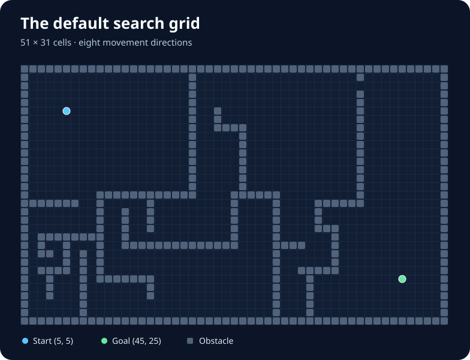

# Grid Search Visualizer

**See how BFS, DFS, and A* explore the same obstacle grid.** This Python and Pygame project animates the cells each algorithm visits and displays the path it returns. You can also draw your own obstacles and save the map as JSON.



*The map above comes from the repository's default scenario. Run the app to see the search animation and resulting path.*

## Quick start

From the repository root, with Python 3 installed:

```bash
python -m pip install -r requirements.txt
python main.py
```

The default run opens a Pygame window, loads [`Maps/default.json`](Maps/default.json), and runs A* from `(5, 5)` to `(45, 25)`.

## Compare the algorithms

Near the bottom of [`main.py`](main.py), change the constructor in the `agent = AStar_Agent(...)` line to `BFS_Agent` or `DFS_Agent`. Keep the map and endpoints the same so you can see how each strategy changes the exploration pattern.

| Algorithm | How it chooses the next cell | What to look for |
| --- | --- | --- |
| Breadth-first search | Takes the oldest entry from the frontier | Expansion in layers measured in moves |
| Depth-first search | Takes the newest entry from the frontier | Long branches and sensitivity to neighbor order |
| A* | Scores the frontier using the path cost so far and a Manhattan estimate | How the goal estimate steers the search |

The grid allows diagonal moves. The current A* implementation uses Manhattan distance even though a diagonal costs less than two straight moves. The animation illustrates heuristic search, but this configuration does not guarantee a minimum-cost path.

## Draw a custom map

1. Copy `Maps/default.json` to `Maps/maze.json`. In `main.py`, set `map_name = "maze"` and `generate_mode = True`.
2. Run `python main.py`. Click grid cells to toggle obstacles. Press **Enter** to save the map.
3. Set `generate_mode = False` and run again. Use clear cells for the start and goal, and leave a route between them for the demo.

## Follow the code

| File | Responsibility |
| --- | --- |
| [`main.py`](main.py) | BFS, DFS, A*, and the demo entry point |
| [`utils/agent.py`](utils/agent.py) | Shared agent interface, neighbors, and path reconstruction |
| [`utils/env.py`](utils/env.py) | Grid size, movement directions, and obstacle loading |
| [`utils/plotting.py`](utils/plotting.py) | Pygame animation and path display |
| [`utils/generator.py`](utils/generator.py) | Interactive obstacle editor and JSON export |
